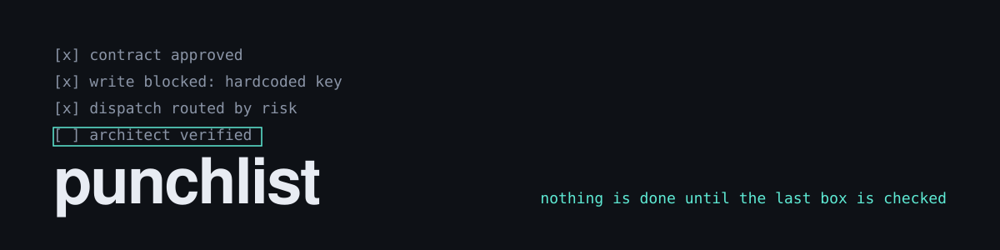
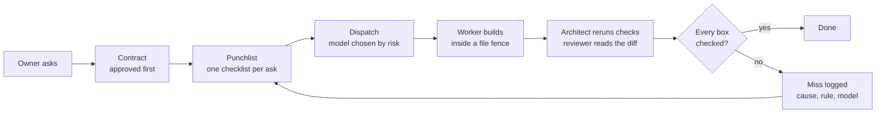

# punchlist

How I work with coding agents, written down as rules and enforced by code.

I run a coding agent the way I would run a small team. Nothing new gets built without a one-page contract I have
approved. Three kinds of unsafe write are refused before they land. Routine work, where a mistake shows up straight
away, goes to a cheaper model, and work where a mistake could go unnoticed goes to the strongest one. Nothing is
called done until someone other than the builder has checked it, and every miss is logged with its cause. This repo
is that way of working.

It is published to be read, as a record of how I build with agents. It is not offered as a product to install.

## What it is

A Claude Code plugin: two skills, five worker definitions, and the hooks that enforce them. Four jobs:

- **Plan.** Before any code on something new, a one-screen contract: what data it touches, what breaks if it is
  wrong, how to roll it back, and the test that proves it. The owner approves it in one message.
- **Gate.** A hook reads every file write before it lands and refuses a hardcoded credential, a table created
  without row-level security, or SQL built by string interpolation. A second hook refuses a dispatch that names
  the top model tier without a reason, and any generic worker sent out with no model set.
- **Route.** Each step is matched to a model by one question: if this goes wrong, will anything tell me? A 200-file
  rename goes to the cheapest model, because a mistake breaks the build straight away. A cleanup pass on one file
  goes to the strongest one, because a mistake there can sit unnoticed for weeks.
- **Prove.** Nothing is done on an agent's say-so. Tests are pasted, a separate reviewer reads the diff, the built
  page is checked in a browser by script, and every miss is logged with its cause.

## How it works

The hooks sit on two of those arrows. On **Dispatch**, a generic worker with no model set is refused, and so is a
dispatch that names the top tier with no stated reason. On **Worker builds**, the three unsafe writes are refused. A
further hook runs at session start and tells the model when to load each skill.

| Part | Count | What it is |
|---|---|---|
| Skills | <!--claim:skills-->2<!--/claim--> | `code` for backends, data and infrastructure; `design` for pages, dashboards and anything with a chart |
| Workers | <!--claim:agents-->5<!--/claim--> | Four implementers and a read-only reviewer, each with a default model tier |
| Hooks | 4 events | At session start, before a write, before and after a dispatch, and when the session stops |

### Rules written as the model's mistake

Most rule files tell a model the right answer, which it already knows. These name the mistake it makes on the way
there. From `skills/code/references/security.md`:

| Rule | What the model does instead |
|---|---|
| Parameterize SQL | Reaches for string interpolation specifically when the query is built conditionally: the fixed query gets a placeholder, the `WHERE` clause assembled across an `if` does not |
| Secrets | Writes a real key "temporarily" to make a test pass, intending to remove it |
| Guard every new route | Copies a neighbouring handler as the template and drops the wrapper that checked the user |

## What it costs to load

A session pays only for what the task in front of it needs.

| Layer | Estimated tokens | When it loads |
|---|---|---|
| Descriptions of both skills and all five workers, and the session-start routing rule | <!--claim:always-on-->659<!--/claim--> | Every session |
| One `SKILL.md` | up to <!--claim:skill-max-->988<!--/claim--> | When the skill is invoked |
| `shared/architect.md` | <!--claim:every-round-->511<!--/claim--> | Every round of work |
| One other reference | <!--claim:on-demand-min-->616<!--/claim--> to <!--claim:on-demand-max-->1,834<!--/claim--> | Only when its trigger fires |
| Everything at once | <!--claim:everything-->23,819<!--/claim--> | Never, by design |

The other half of the cost is what is not here. Process, terse output, static design audits, deep security analysis
and database tuning are left to skills that already do them well, and named at the top of each `SKILL.md`. No rule
is copied in, so an upstream change never contradicts a local copy.

## In use

I have worked this way since August 2026. Over twelve weeks on one project, the ledger logged
<!--claim:ledger-rows-->212<!--/claim--> subagent dispatches and the gate blocked
<!--claim:gate-blocked-->8<!--/claim--> unsafe writes, with <!--claim:gate-override-->2<!--/claim--> reasoned overrides.

The contracts, punchlists and ledgers this process produces can be seen in a project built with it:
[plant-care-rag](https://github.com/keeganleach3/plant-care-rag), under `docs/contracts/` and
`docs/superpowers/plans/`.

## More

- [docs/architecture.md](docs/architecture.md): a round of work, what loads when, and how a miss becomes a check, as diagrams.
- [docs/decisions/](docs/decisions/): why each main choice was made and what it costs.
- [docs/origins.md](docs/origins.md): each design rule and the feedback that caused it.
- [examples/](examples/): a filled contract and a routing table for a `CLAUDE.md`.

## Credits

- A few of the repo's own checks are adapted from ideas in
  [Claude-BugHunter](https://github.com/elementalsouls/Claude-BugHunter).
- "The lethal trifecta" in the prompt-injection rules is Simon Willison's term.

## License

MIT. See [LICENSE](LICENSE).
