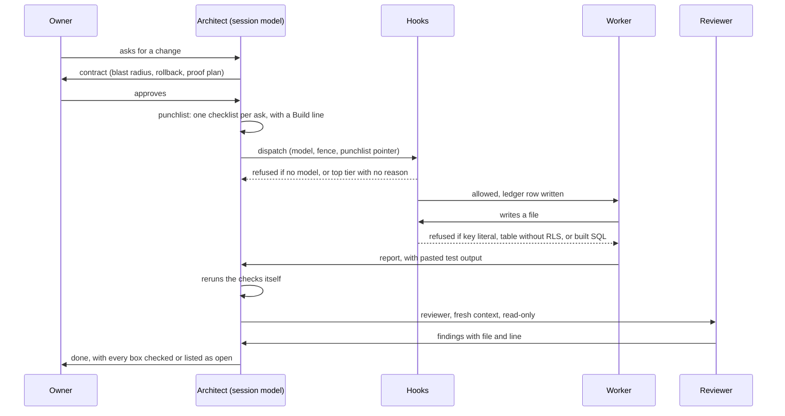
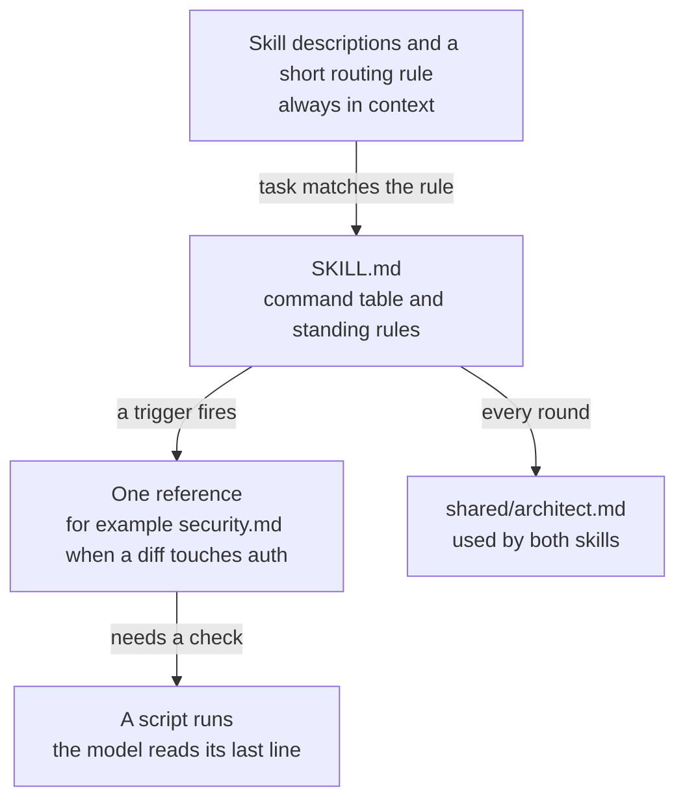
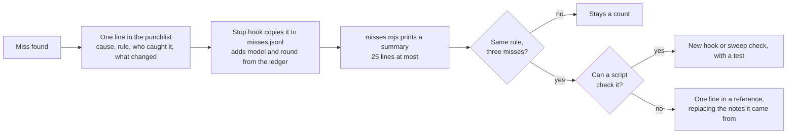

# Architecture

Three pictures: how a round of work runs, what loads when, and how a miss becomes a check.

## 1. A round

The session model is the architect. It plans, hands out work by rule, and is the only one that calls anything done.

Where each rule lives:

| Step | File |
|---|---|
| Contract | `skills/code/references/contract.md`, `skills/design/references/contract.md` |
| When to dispatch, builder is not reviewer | `shared/architect.md` |
| Dispatch prompts and the punchlist | `shared/dispatch.md` |
| Which model for which step | `skills/code/references/models.md` |
| Dispatch guard, ledger, Stop audit | `hooks/dispatch.mjs` |
| Write-time gate | `hooks/scan.mjs`, `hooks/detectors.mjs` |
| Checks before "done" | `skills/code/references/verify.md`, `skills/design/references/verify.md` |

## 2. What loads when

Nothing is loaded until it is needed. The sizes are in `evidence/sizes.json`.

`scripts/skill-lint.mjs` caps `SKILL.md` and each reference in tokens. A file that grows past its cap fails
`npm run lint`, which CI runs, so the layers cannot drift into each other.

## 3. From a miss to a check

A miss is a step that had to be redone, or that the owner caught after it was called done.

Two side branches stop a round from looping. A second miss on the same ask with nothing changed is flagged when the
session stops. A third miss on the same ask stops the work and sends the record to the owner.

The cause decides the fix. An ask that was ambiguous goes back to the owner, because a stronger model reads the same
ambiguity. A miss coded `under-tiered` is the evidence for moving that kind of work up a tier. The causes and what
each points to are in `shared/misses.md`.
